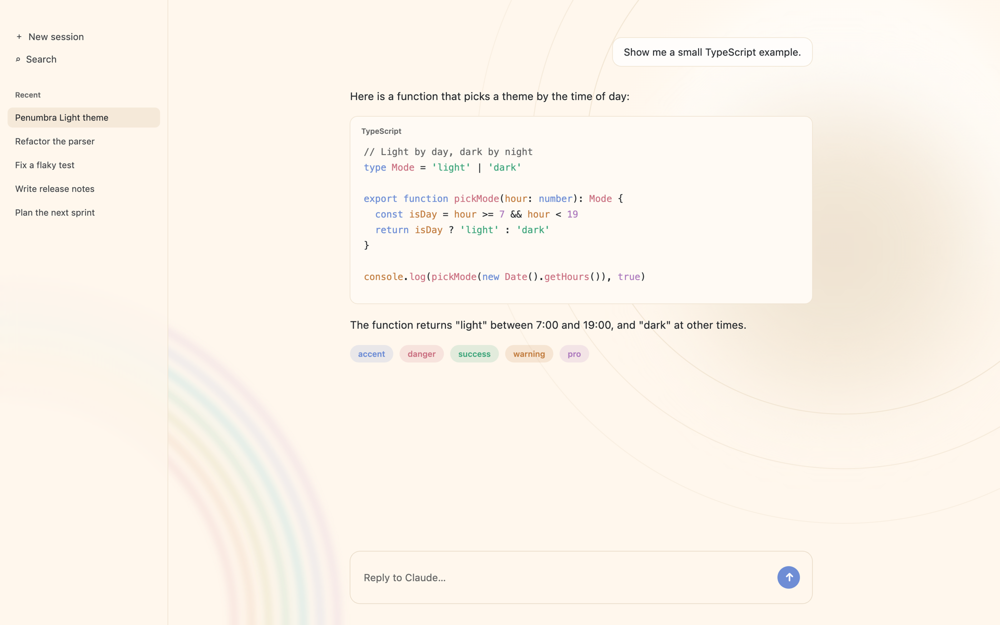

# Penumbra Light for Claude

A light theme for the Claude desktop and mobile apps, based on the
[Penumbra](https://github.com/nealmckee/penumbra) color palette.



*A rendered preview of the colors and backdrop, not a screenshot of the app.*

- Warm "sun" surfaces (`#FFF7ED` to `#FFFDFB`) and neutral "shade" text (`#24272B`).
- The balanced Penumbra accents: blue, red, green, orange and purple.
- A soft, slowly moving eclipse backdrop, with a faint arc in the seven Penumbra colors.
  It stays still when your system asks for reduced motion.

The theme draws only in the desktop and mobile apps. The terminal and editors keep their own look.

## Install

At the prompt of a Claude Code session:

```
/plugin install penumbra-light --marketplace choyongjoon/claude-penumbra-light
```

Type `y` to add the marketplace, then pick a scope.

From a shell:

```bash
claude plugin install penumbra-light --marketplace choyongjoon/claude-penumbra-light
```

The theme applies when a session starts.

## Credits

The color palette is [Penumbra](https://github.com/nealmckee/penumbra) by Neal McKee.
This is an unofficial port.

## License

[MIT](LICENSE)
